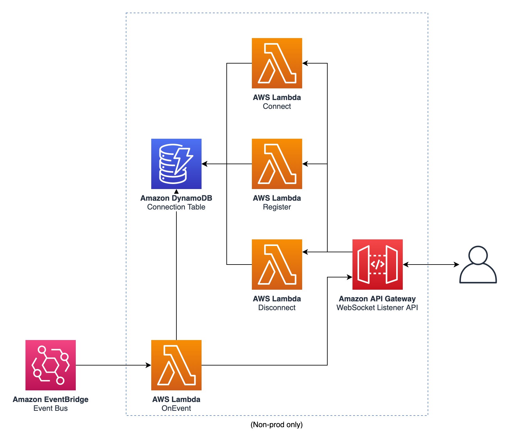

# ACME Shop: Commerce Platform

Shared commerce event bus, event archive and the real-time notification channel used by back-office screens.

- Component: `platform` (service, production)
- Owner: **cloud-platform-team**
- System: `commerce-platform`

## Origin and license

This repository is derived from [aws-samples/aws-serverless-ecommerce-platform](https://github.com/aws-samples/aws-serverless-ecommerce-platform) at commit [`3b9ef36`](https://github.com/aws-samples/aws-serverless-ecommerce-platform/tree/3b9ef36dd3e338c8ab697c2bcb1b672e064e303c), split out of that monorepo with its commit history and modified as listed below. Original code: Copyright 2019 Amazon.com, Inc. or its affiliates, licensed under MIT-0 (see [LICENSE](LICENSE)).

ACME Retail Group is a fictional company used for demos. This repository is not affiliated with, or endorsed by, Amazon Web Services.

## Changes from upstream

- Split out of the upstream monorepo into one repository per service, with history.
- The shared `ecom` library is installed from [acme-shop-ecom-lib](https://github.com/kaku0/acme-shop-ecom-lib) instead of a relative path.
- SSM-backed template parameters have a `dev` default, so the template can be read on its own.
- `catalog-info.yaml` (Backstage) describes ownership, system, APIs and dependencies.
- Root `environments.yaml` and the estate-wide `docs/` (decision log, conventions) live here.

---

Platform service
================

## API

_This service does not expose a REST API_

## Events

_This service does not emit any event_

## SSM Parameters

This service defines the following SSM parameters:

* `/ecommerce/{Environment}/platform/event-bus/name`: Event Bus Name
* `/ecommerce/{Environment}/platform/event-bus/arn`: Event Bus ARN
* `/ecommerce/{Environment}/platform/listener-api/url`: URL for the WebSocket Listener API
